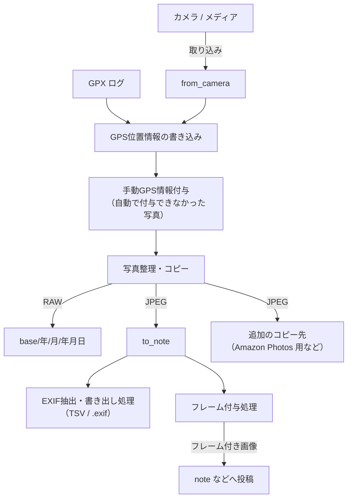

# PhotoWorkflow

カメラから取り込んだ写真に位置情報を付け、RAW と JPEG を整理してコピーし、ブログ（note など）に載せるためのフレーム付き画像を作るまでを、まとめて行う写真整理ツールです。

- バージョンと変更履歴: [CHANGELOG.md](CHANGELOG.md)
- 動作環境: Windows（Python 3.9 以上と [ExifTool](https://exiftool.org/)）

## 主な機能

メニューから次の5つのステップを1つずつ、または順にまとめて実行できます。

1. **GPS位置情報の書き込み**
   - GPS ロガーなどの GPX ログをもとに、写真（JPEG・RAW）へ位置情報を書き込みます。
   - 既に位置情報がある写真は書き換えません。カメラ時計のずれも補正できます。
   - 付与できなかった写真は、理由（GPX の記録範囲外・撮影日時なし など）とあわせて表示します。
2. **手動GPS情報付与**
   - 地図をクリックして位置を選び、写真へ書き込む GUI ツールです（住所検索にも対応）。
   - 自動で付与できなかった写真に使います。
3. **写真整理・コピー**
   - JPEG を `to_note` と追加のコピー先（Amazon Photos 用フォルダなど）へコピーします。
   - RAW を撮影日ごとのフォルダ（年/月/年月日）へコピーします。
   - コピーに成功したファイルだけを、取り込み元からゴミ箱へ移します。
4. **EXIF抽出・書き出し処理**
   - `to_note` の写真の EXIF を、全タグの一覧（TSV）と写真ごとの `.exif` ファイルに書き出します。
5. **フレーム付与処理**
   - 写真に余白・撮影データ（カメラ・レンズ・F値・シャッタースピード・ISO など）・ロゴを付けます。
   - レイアウトは YAML で自由に決められます。作成済みのものは飛ばし、新しい写真だけを処理します。

どのステップも、写真1枚ごとの進み具合を同じ形で表示し、詳細を `photo_organizer.log` に記録します。

---

## 処理フロー概要



---

## セットアップ

1. Python 3.9 以上と [ExifTool](https://exiftool.org/) をインストールする。
2. 必要なパッケージをインストールする。

   ```
   pip install -r requirements.txt
   ```

3. `config.example.json` を `config.json` という名前でコピーし、フォルダや exiftool のパスを自分の環境に合わせて書き換える。
   `config.json` は個人の環境に合わせたファイルなので Git の管理対象外（`.gitignore`）にしてある。
4. （任意）フレームにカメラメーカーなどのロゴを入れる場合は、ロゴ画像（背景が透明な PNG）を `main.py` と同じフォルダに `nikon_logo.png` という名前で置く。
   別の名前・場所にする場合は、レイアウトの YAML の `logo.path` で指定する。
   ロゴ画像は各社の商標のため、このリポジトリには含めていない。置かなければ、ロゴなしでフレームを作る。

---

## 使い方

```
python main.py
```

起動するとメニューが表示され、実行したいステップを番号で選びます。選んだステップだけを実行し、終わるとメニューに戻ります。

```
==================================================
      写真整理ワークフロー  メニュー
==================================================
  取り込み元: C:\SHARE\Photo\from_camera
    JPEG 120 件 / RAW 120 件 / GPX 2 件
--------------------------------------------------
  [1] GPS位置情報の書き込み
  [2] 手動GPS情報付与
  [3] 写真整理・コピー
  [4] EXIF抽出・書き出し処理
  [5] フレーム付与処理
  [A] 全ステップを順に実行（各ステップの前に確認あり）
  [Q] 終了
--------------------------------------------------
番号を入力してください:
```

### 処理中の表示

どのステップも、写真1枚ごとに進み具合を表示します。表示の形は2通りあり、`config.json` の `display.per_file` で選べます。

**1行を上書き（既定。`"per_file": false`）** — 進み具合のバー・件数・残り時間・今のファイル名を1行で更新します。問題があった写真（失敗・撮影日なしなど）は、その場に警告として1行ずつ残ります。

```
==================================================
 【開始】写真整理・コピー
==================================================
  JPEG をコピー       [####################] 100%  120/120  完了（12秒）
 -> RAW の撮影日を読み取り中...（120 枚）
  [警告] DSC_0077.NEF: unknown に保存（撮影日なし）
  RAW をコピー        [##########----------]  52%   63/120  残り 約6秒  DSC_0063.NEF
```

**1枚ごとに1行（`"per_file": true`）** — 処理した写真を1行ずつ表示します。

```
  [ 1/120]   0%  DSC_0001.NEF  RAW をコピー        完了 → 2026/11/20261101
  [ 2/120]   1%  DSC_0002.NEF  RAW をコピー        unknown に保存（撮影日なし）
  ...
  RAW をコピー: 120/120 件 完了（12秒、うち要確認 1 件）
```

画面ではなくファイルに出力しているとき（タスクスケジューラなど）は、上書きができないため自動で「1枚ごとに1行」になります。
各段階の最後の行の「うち要確認 N 件」は、失敗やスキップなど確認が必要な写真の数です。詳しい記録は `photo_organizer.log` に残ります。

- 取り込み元フォルダがなくても、「EXIF抽出・書き出し処理」と「フレーム付与処理」（`to_note` が対象）は実行できます。
- `config.json` の `steps` で無効にしたステップは「※config で無効」と表示され、実行できません。
- ステップ実行中に Ctrl+C を押すと、そのステップを中断してメニューに戻ります。

### コマンドラインオプション

| オプション | 内容 |
|---|---|
| `--step STEP` | メニューを出さずに指定したステップだけを実行（複数指定可。例: `--step gps_tag --step copy`） |
| `--all` | メニューを出さずに全ステップを順に実行（各ステップの前に確認あり） |
| `--yes`, `-y` | メニューを出さずに全ステップを確認なしで実行（タスクスケジューラなど無人実行向け） |
| `--skip STEP` | 全ステップ実行時に指定したステップを飛ばす |
| `--dry-run` | ファイル操作をせず、実行予定のステップだけ表示 |
| `--list-steps` | ステップ名の一覧を表示 |
| `--version` | バージョンを表示 |
| `--config PATH` | 使用する `config.json` を指定（見つからない場合はエラーで終了。省略時は `main.py` のあるフォルダ → カレントディレクトリの順に探す） |

ステップ名: `gps_tag` / `manual_gps` / `copy` / `exif_export` / `frame`

## 設定（config.json）

必須の項目と、よく変える項目は `config.example.json` に書いてあります。
次の項目は書かなければ既定値（`modules/constants.py`）を使います。変えたい項目だけを書いてください。

| キー | 内容 |
|---|---|
| `camera_name_rules.replacements` / `removes` / `brand_replacements` | カメラ・レンズ名の表記ゆれ補正（例: `"Z50_2": "Z50II"`）。書いた種類だけ既定値を置き換える |
| `exif_export.target_tags` | EXIF抽出・書き出しで写真ごとの `.exif` に書き出すタグ（順番もこのとおり） |
| `exif_export.tag_labels` | 上のタグの見出し（例: `"ExifIFD:ISO": "ISO感度"`）。書いたタグだけ既定の見出しを置き換える |
| `display.per_file` | 処理中の表示を「1枚ごとに1行」にする（`true`）。既定は `false`（1行を上書き）。上の「処理中の表示」を参照 |
| `frame.workers` | フレーム付与で並列に処理するプロセス数。既定は CPU 数（最大 4）。`1` にすると1枚ずつ処理する |
| `frame.overwrite_existing` | `true` にすると、フレーム付き画像が作成済みの写真も毎回すべて作り直す。既定は `false`（作成済みで、元の写真とレイアウトの YAML より新しいものは飛ばす。YAML を書き換えた後は自動で作り直す） |

例:

```json
"exif_export": {
  "tag_labels": { "ExifIFD:ISO": "ISO感度" }
},
"frame": { "workers": 2 }
```

## フレームのレイアウト設定（YAML）

フレーム付与のフレームは `config.json` の `external_tools.flame_config` で指定した YAML（`standard.yaml` / `black.yaml` など）で見た目を決めます。
従来の書き方はそのまま使えます。さらに次の設定を追加できます（すべて省略可。全項目の例は `custom_example.yaml`）。

YAML 内のフォント・ロゴの相対パスは、YAML のあるフォルダ → `main.py` のあるフォルダの順に探します（起動したフォルダには依存しません）。

長さは、数値なら「写真の長辺に対する比率」、`"80px"` のような文字列ならピクセル数です。

| セクション | キー | 内容 |
|---|---|---|
| `canvas` | `margins.top` / `bottom` / `left` / `right` | 上下左右の余白を個別に指定（`ratios` より優先） |
| | `aspect_ratio` | キャンバス全体の比率（例: `"1:1"`, `"4:5"`）。足りない分の余白を自動で追加 |
| | `aspect_ratio_portrait` | 縦長写真だけに使う比率 |
| | `aspect_fill` | 高さを足すときの配分: `center` / `bottom` / `top` |
| `layout` | `lines` | 行のリスト（何行でも可）。各行に `text` / `font` / `size` / `color` / `align` / `spacing` を指定 |
| | `align` | 全行の揃え: `left` / `center` / `right` |
| | `align_to` | 揃えの基準: `image`（写真の端）/ `canvas`（キャンバスの端） |
| | `padding_x` | 左右揃えのときの端からの距離 |
| | `text_area` | 文字を置く余白: `bottom` / `top` |
| | `vertical_align` | `padding`（従来どおり `top_padding_ratio`）/ `center`（余白の中央） |
| | `line_spacing` / `y_offset` | 行の間隔・全体の上下位置（比率でも指定でき、画像サイズに合わせて変わる） |
| `logo` | `enabled` / `path` | ロゴの表示有無と画像ファイル（画像は同梱していない。「セットアップ」の4を参照） |
| | `height` / `height_font_ratio` | ロゴの高さ（直接指定、または1行目の文字サイズ×倍率） |
| | `position` | `left` / `center` / `right` / `text_left` / `text_right`（文字の隣） |
| | `vertical` | `bottom` / `center` / `top` / `text`（文字ブロックの中央） |
| | `offset_x` / `offset_y` / `gap` / `opacity` | 位置の微調整、文字との間隔、不透明度 |
| | `left` / `top` | キャンバス左上からの座標で直接指定（`position` / `vertical` より優先。片方だけでも可） |

`layout.lines` を書いた場合は `layout.top` / `layout.bottom` と `fonts.main_size` / `sub_size` は不要です。
テンプレートに存在しない項目（例: `{unknown}`）は空文字になり、処理は止まりません。

## 地図ライブラリの更新

手動GPS付与ツールの地図は、ライブラリ（Leaflet と住所検索の Leaflet Control Geocoder）を
版番号を固定して読み込み、`integrity`（ファイルのハッシュ値）で中身が差し替えられていないことを確かめています。
地図そのもの（地図データ）は常に最新のものが表示されます。ライブラリの版を上げるときは次を実行します。

```
python tools/update_map_libs.py --dry-run    # 更新できる版を表示するだけ（書き換えない）
python tools/update_map_libs.py              # 大きな版（1.x など）は変えずに、その中の最新版へ
python tools/update_map_libs.py --major      # 大きな版も含めて最新版へ
```

- `modules/manual_gps_tagger.py` の版番号と `integrity` をまとめて書き換えます。
- 公開から7日たっていない版、ベータ版、npm で非推奨とされた版は選びません（`--min-age-days 0` で公開直後の版も選べます）。
- unpkg から取得したファイルが npm の配布ファイルと同じ中身であることを確かめてから、ハッシュ値を計算します。
- 更新したら、手動GPS付与ツールを起動して地図と住所検索が動くか確認してください。
  動かない場合は `git checkout -- modules/manual_gps_tagger.py` で元に戻せます。
  `--major` で大きな版を上げたときは、ライブラリの使い方が変わって地図が表示されなくなることがあります。

## バージョンと変更履歴

今のバージョンは、メニューの見出しと次のコマンドで確認できます。起動するたびにログ（`photo_organizer.log`）にも記録されます。

```
python main.py --version
```

変更の内容は [CHANGELOG.md](CHANGELOG.md) に記録します。

### バージョン番号の付け方

`1.2.3` のように「大きな変更.機能の追加.不具合の修正」の3つの数字で表します（[セマンティック バージョニング](https://semver.org/lang/ja/)）。

| 変更の種類 | 上げる数字 | 例 |
|---|---|---|
| 不具合の修正だけ | 3つ目 | 1.0.0 → 1.0.1 |
| 機能の追加・改善（今までの設定・使い方のまま動く） | 2つ目（3つ目は0に戻す） | 1.0.1 → 1.1.0 |
| `config.json` の書き方が変わるなど、今までの設定・使い方のままでは動かない変更 | 1つ目（2つ目・3つ目は0に戻す） | 1.1.0 → 2.0.0 |

### 変更を加えるとき

変更をコミットするたびに、`CHANGELOG.md` の「未リリース」に内容を書き足します。見出しは次の4つを使います。

- **追加**: 新しい機能
- **変更**: 今までの機能の動きや表示の変更
- **修正**: 不具合の修正
- **削除**: なくした機能

### 新しいバージョンを公開するとき

1. `CHANGELOG.md` の「未リリース」の見出しを、新しい番号と日付（例: `## [1.1.0] - 2026-12-01`）に書き換え、その上に空の「未リリース」を作り直す。
   ファイル末尾のリンク（`[1.1.0]: https://github.com/.../releases/tag/v1.1.0` など）も追加する。
2. `modules/__init__.py` の `__version__` と、`pyproject.toml` の `version` を新しい番号にする。
3. `pytest` を実行して、すべて通ることを確かめる（番号が3か所でそろっているかも確かめる）。
4. コミットして、バージョンのタグを付けて push する。

   ```
   git add -A
   git commit -m "v1.1.0"
   git tag v1.1.0
   git push
   git push origin v1.1.0
   ```

5. 必要なら GitHub の「Releases」で、タグ `v1.1.0` のリリースを作り、`CHANGELOG.md` のその版の内容を貼る。

---

## 開発

```
pip install -r requirements-dev.txt
pytest
```

`tests/` のテストのうち exiftool を使うものは、exiftool が見つからない環境では自動でスキップされます。

### 各モジュールを単独で実行する

`main.py` のあるフォルダで、`python -m` を付けて実行します（`python modules/xxx.py` のようにファイルを直接実行すると、実行方法の案内が出て終了します）。

```
python -m modules.frame_processor <画像ファイルまたはフォルダ> [YAMLのパス]
python -m modules.exif_exporter <対象フォルダ> [TSVファイル名] [exiftoolのパス]
python -m modules.manual_gps_tagger
```

### コードの構成

| ファイル | 内容 |
|---|---|
| `LICENSE` | ライセンス（MIT） |
| `CHANGELOG.md` | 変更履歴 |
| `modules/__init__.py` | バージョン番号（`__version__`） |
| `main.py` | メニュー・コマンドラインオプション・ステップの順番 |
| `modules/console.py` | 画面表示（見出し・まとめ・進み具合の行）。処理の関数は画面に直接表示せず、各ステップの入口がここを使って表示する |
| `modules/gps_tagger.py` | GPS位置情報の書き込み（処理は `geotag_photos()`、画面表示つきの入口は `apply_gps_tags()`） |
| `modules/manual_gps_tagger.py` | 手動GPS付与ツール（GUI） |
| `modules/photo_copier.py` | 写真整理・コピー（処理は `copy_jpegs()` / `copy_raws()` / `trash_files()`、入口は `copy_and_organize_photos()`） |
| `modules/exif_exporter.py` | EXIF抽出・書き出し |
| `modules/frame_processor.py` | フレーム付与（処理は `ImageProcessor`、入口は `run_frame_processing()`） |
| `modules/config_manager.py` / `constants.py` | 設定の読み込みと既定値 |
| `modules/exiftool_client.py` / `exif_utils.py` | exiftool の呼び出しと EXIF の値の変換 |
| `tools/update_map_libs.py` | 地図ライブラリの更新 |

---

## ライセンス

このプログラムは [MIT ライセンス](LICENSE)で公開しています。

`fonts/` フォルダのフォント（[Rubik](https://github.com/googlefonts/rubik)、[Sofia Sans](https://github.com/lettersoup/Sofia-Sans)）は、それぞれの作者が [SIL Open Font License 1.1](fonts/OFL.txt) で配布しているもので、MIT ライセンスの対象外です。
